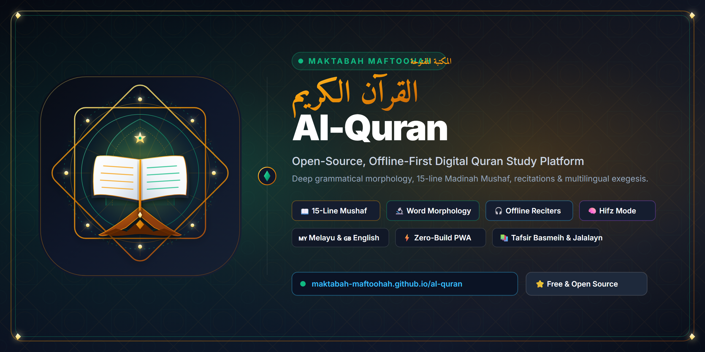

<p align="center">
  
</p>

# Maktabah Maftoohah — Al-Quran (المكتبة المفتوحة)

[](https://maktabah-maftoohah.github.io/al-quran/)
[](https://github.com/maktabah-maftoohah/al-quran/releases)
[](LICENSE)
[](manifest.webmanifest)
[](js/app.js)

**Maktabah Maftoohah Al-Quran** is an open-source, zero-build, offline-first digital Quran study web application and Progressive Web App (PWA). It provides a fast, distraction-free environment for reading, listening, memorizing, and deeply analyzing the Holy Quran with word-by-word grammatical morphology, multilingual translations, and audio recitations.

🌐 **Live Web Application:** [https://maktabah-maftoohah.github.io/al-quran/](https://maktabah-maftoohah.github.io/al-quran/)

---

## 🌟 Key Features

### 📖 Authentic Quranic Text & Traditional Mushaf
* **Complete Quran Dataset**: All 114 Surahs and 6,236 verses in verified Uthmani script.
* **15-Line Madinah Mushaf View**: Accurate page-by-page rendering mapping all 604 standard Madinah pages (`#mushaf/{page}`) with verse markers and quick page jumps.
* **Royal Frontispiece Illuminations**: Authentic decorative crown arches and surah cartouches for Pages 1 (Al-Fatihah) and 2 (Al-Baqarah).
* **Marginal Markers & Tilawah Indicators**: Precise Juz, Hizb, Rub' al-Hizb medallions, and Sajdah Tilawah indicators matching the King Fahd Glorious Quran Printing Complex layout.
* **RTL Navigation & Auto-Flipping**: True Right-to-Left toolbar page navigation and automatic page-turning when reciting across page boundaries.
* **Basmalah Placement Logic**: Automatically displays the decorative Basmalah banner on appropriate chapters while correctly omitting it on Surah 9 (At-Tawbah), adhering to Islamic tradition.
* **Direct Ayah Deep-Linking**: Jump directly to any verse with auto-scroll and highlight using compact notation (`#6:12`), standard route (`#surah/6/12`), or deep-dive route (`#ayah/6/12`).

### 🔬 Word-by-Word Morphology & Deep-Dive
* **Token-Level Analysis**: Interactive Arabic token cards showing phonetic transliteration, Malay/English gloss, part-of-speech (POS) tags, lemmas, and root words (`الجذر`).
* **Slide-out Grammar Drawer**: Detailed syntactic and linguistic breakdowns per word with direct references to the Quranic Arabic Corpus.
* **Tafsir al-Jalalayn & Ibn Kathir**: Integrated classical exegesis available directly inside the Ayah Deep-Dive view (featuring Bahasa Melayu / Nusantara and English).

### 🌍 Multilingual Translations, Jawi Script & Dual-Language UI
* **Dual-Language Interface (MY / EN)**: Complete native localization in **Bahasa Melayu (Default)** and **English**, with instant one-click switching via header and settings controls.
* **Official Malaysian Surah Names & Titles**: In Malay mode, surah names and translations follow Malaysian standard transliteration and titles (e.g., *Al-Fatihah: Pembukaan*, *Al-Baqarah: Lembu Betina*, *Ali 'Imran: Keluarga Imran*, *An-Nisa': Wanita*, etc.).
* **Smart Single-Translation Display**: Automatically hides repetitive translation source headers when only one translation is selected for a pristine, distraction-free reading experience.
* **5 Full Translation & Exegesis Editions**:
  * 🇲🇾 **Bahasa Melayu (JAKIM - Default)** — *Tafsir Pimpinan Ar-Rahman* (Sheikh Abdullah Muhammad Basmeih / JAKIM)
  * 🇲🇾 **Tafsir al-Jalalayn** — Classical Exegesis in Bahasa Melayu / Nusantara (Jalaluddin al-Mahalli & Jalaluddin as-Suyuti)
  * 🇬🇧 **English** — Saheeh International
  * 🇬🇧 **English (Literary)** — Muhammad Marmaduke Pickthall
  * 🇮🇩 **Bahasa Indonesia** — Kementerian Agama Republik Indonesia (Kemenag)
* **Selective Translation Loading**: Dynamic fetching only downloads active translations, saving network bandwidth.
* **Dynamic Jawi Transliteration**: Built-in algorithmic Rumi-to-Jawi transliterator (`tulisan Jawi`) for Malay readers.

### 🎧 Audio Recitation Engine & Offline Storage
* **Continuous & Verse-by-Verse Audio**: Sticky bottom audio player with auto-scroll and auto-advance.
* **World-Renowned Reciters**:
  * Mishary Rashid Alafasy
  * Abu Bakr Al-Shatri
  * Abdul Basit Murattal
* **Word Pronunciation**: Click any individual word token in the Deep-Dive view to hear its pronunciation.
* **Offline Audio Storage**: Download full Surah audio packages directly into browser IndexedDB storage for offline listening without an internet connection.

### 🧠 Tahfiz / Hifz Memorization Mode
* **Active Recall Testing**: Toggle Hifz mode to blur Arabic text and test your memory.
* **Tap-to-Reveal**: Tap or click any blurred verse to reveal the text for immediate self-correction.
* **Interval Looping**: Set custom verse repeat counts and playback intervals to reinforce memorization.

### ⚡ Off-Thread Search Web Worker
* **Dedicated Web Worker**: Instant search queries executed off the main UI thread, keeping the interface fluid and responsive across all 6,236 verses.
* **Normalized Arabic Matching**: Automatically strips diacritics (tashkeel), hamza variants, and alif waslah.
* **Instant Verse Jump**: Type `112:1`, `2:255`, or `36` to immediately jump to any chapter or verse.

### 🎨 Shareable Verse Card Generator
* **HTML5 Canvas Export**: Generate high-resolution, aesthetic Quran verse cards.
* **Aspect Ratios**: Export in **1:1 (Square)** for social feeds or **9:16 (Story/Reels)** for mobile statuses.
* **Native Web Share**: Share directly to social media and messaging apps via the Web Share API, copy the image to clipboard, or download as PNG.

### 📝 Personal Study Notes & 1-Click Backup
* **Persistent Notes Engine**: Write personal reflections, tafsir notes, and study annotations directly on any verse, securely stored in IndexedDB.
* **1-Click JSON Backup & Restore**: Export all bookmarks, personal notes, and UI preferences into a timestamped JSON file with instant one-click restoration.
* **Distraction-Free Sidebar Collapse**: Toggle the sidebar via <kbd>[</kbd> shortcut or sidebar header button.
* **Screen Wake Lock API**: Keep your device display awake without dimming while reading or memorizing.

---

## ⌨️ Keyboard Shortcuts

| Shortcut | Action |
| :--- | :--- |
| <kbd>/</kbd> | Open Search & Verse Jump Modal |
| <kbd>[</kbd> | Toggle Sidebar (Distraction-Free Reading) |
| <kbd>Esc</kbd> | Close Modal, Drawer, or Popover |
| <kbd>Space</kbd> | Play / Pause Current Audio |
| <kbd>Alt</kbd> + <kbd>→</kbd> | Next Ayah |
| <kbd>Alt</kbd> + <kbd>←</kbd> | Previous Ayah |

---

## 🔗 URL Routing & Deep-Linking

The application features a flexible hash-based router supporting instant bookmarking and sharing:

| URL Route | Destination |
| :--- | :--- |
| `/#1` or `/#surah/1` | Open Surah 1 (Al-Fatihah) |
| `/#6:12` or `/#surah/6/12` | Jump directly to Surah 6, Ayah 12 with auto-scroll and highlight |
| `/#ayah/1/1` | Open Ayah Deep-Dive view with morphology breakdown and tafsir |
| `/#mushaf/1` | Open Madinah Mushaf page view (pages 1 to 604) |
| `/#search/iman` | Pre-populate and execute a search query |

---

## 🏗️ Technical Architecture & Invariants

This project adheres to strict architectural principles designed for longevity, performance, and simplicity:

1. **Zero-Build ES6**:
   * Pure native ES6 modules (`import` / `export`) executed directly by modern browsers.
   * Zero bundlers (no Webpack, Vite, Rollup, or Babel).
   * Zero npm runtime dependencies.
2. **Subpath Hosting Compatibility**:
   * All network requests use strictly relative paths (`./data/...`, `./css/...`, `./js/...`), ensuring flawless execution on subpath environments like GitHub Pages (`https://<org>.github.io/<repo>/`).
3. **Offline-First PWA (Service Worker v14)**:
   * Stale-while-revalidate caching provides instantaneous offline boot while seamlessly pulling background updates from GitHub.
4. **Storage Architecture**:
   * **IndexedDB** (`maktabah_quran_db`): Persistent offline audio MP3 blobs and user study notes.
   * **localStorage**: UI preferences, bookmarks, and last-read marker.
   * **Cache Storage**: App shell, stylesheets, icons, and Quran JSON datasets.
5. **Strict Data Schemas & UTF-8 Encoding**:
   * All files use UTF-8 encoding without BOM.

---

## 📁 Repository Structure

```
al-quran/
├── .agents/
│   └── skills/
│       └── quran-etl/
│           └── SKILL.md             # Quran ETL pipeline skill instructions
├── .github/
│   └── workflows/
│       └── deploy.yml               # GitHub Pages automated CI/CD pipeline
├── css/
│   └── style.css                    # Responsive layout, typography, dark theme
├── data/
│   ├── arabic/                      # 114 Uthmani & simple clean chapter files
│   ├── morphology/                  # 114 Word-by-word token analysis files
│   ├── translations/                # Multilingual translations & exegesis
│   │   ├── en/                      # English (sahih.json, pickthall.json)
│   │   ├── id/                      # Indonesian (kemenag.json)
│   │   └── ms/                      # Malay (basmeih.json, jalalayn.json)
│   ├── pages-meta.json              # 604 Madinah Mushaf page definitions
│   ├── search-index.json            # Search index for all 6,236 verses
│   ├── surahs.json                  # 114 Surah catalogue with official names
│   └── icon.svg                     # Application vector icon
├── js/
│   ├── app.js                       # Application coordinator & controller
│   ├── audio.js                     # HTML5 Audio recitation engine
│   ├── backup.js                    # 1-Click JSON backup & restore manager
│   ├── card-generator.js            # HTML5 Canvas verse card generator
│   ├── i18n.js                      # Dual-language internationalization (MY / EN)
│   ├── jawi.js                      # Algorithmic Rumi-to-Jawi transliterator
│   ├── mushaf.js                    # 15-line Madinah Mushaf renderer
│   ├── router.js                    # Hash-based SPA deep-linking router
│   ├── search-worker.js             # Dedicated background search Web Worker
│   ├── search.js                    # Search modal UI & keyboard handler
│   ├── storage-db.js                # IndexedDB storage engine
│   ├── store.js                     # Reactive state management
│   └── wake-lock.js                 # Screen Wake Lock API controller
├── scripts/
│   ├── extract_quran.py             # Python ETL pipeline for data extraction
│   ├── serve.py                     # Zero-dependency local dev server (no-cache)
│   ├── test_mushaf_authentic.js     # Authentic Madinah Mushaf test suite (10 checks)
│   ├── test_release_qa.js           # Playwright master QA suite (81 checks)
│   ├── test_ui_comprehensive.js     # Automated UI & responsive test suite (35 checks)
│   ├── update_surah_names_ms.py     # Malaysian standard transliterations updater
│   ├── verify_data_integrity.py     # Dataset schema and encoding validator
│   └── verify_project.py            # Project invariants and relative path validator
├── index.html                       # Semantic HTML5 entry point
├── manifest.webmanifest             # Progressive Web App manifest
├── sw.js                            # PWA Service Worker (v14)
├── AGENTS.md                        # Project invariants & instructions for AI agents
├── CONTRIBUTING.md                  # Contribution guidelines & workflow
├── LICENSE                          # MIT License
├── package.json                     # Playwright testing & npm scripts
└── README.md                        # Project documentation
```

---

## 🚀 Local Development

Because this project uses a zero-build architecture, no compilation is required. Simply serve the repository root with any local HTTP server:

### Option 1: Using the Built-In Local Development Server (Recommended)
```bash
# Automatically launches default browser with no-cache headers enabled:
python scripts/serve.py --port 8000
# or:
npm run serve
```

### Option 2: Using Standard Python HTTP Server
```bash
python -m http.server 8080
```
Open [http://localhost:8080](http://localhost:8080) in your browser.

### Option 3: Using Node.js
```bash
npx serve .
```

---

## 🧪 Testing & Verification

The project includes comprehensive automated verification suites covering data integrity, architectural invariants, and end-to-end browser workflows:

```bash
# 1. Verify Project Invariants, Relative Paths & Schemas
python scripts/verify_project.py

# 2. Verify Quranic Data Integrity (114 Surahs, 6,236 Verses, Schemas & UTF-8)
python scripts/verify_data_integrity.py
# (Or run both via: npm run verify)

# 3. Run Master QA Playwright Test Suite (81 Checks)
npm test
# or: node scripts/test_release_qa.js

# 4. Run Comprehensive UI & Responsive Test Suite (35 Checks)
npm run test:ui
# or: node scripts/test_ui_comprehensive.js

# 5. Run Authentic Madinah Mushaf Test Suite (10 Checks)
npm run test:mushaf
# or: node scripts/test_mushaf_authentic.js
```

---

## 📚 Data Sources & Acknowledgments

We express our gratitude to the open-source and Islamic scholarship communities whose public resources power this project:

* **[Tanzil Project](https://tanzil.net)** — Verified Quranic Uthmani text and transliterations.
* **[Quranic Arabic Corpus](https://corpus.quran.com)** — Morphological and syntactic treebank data developed by the Language Research Group at the University of Leeds.
* **[EveryAyah.com](https://everyayah.com)** — High-quality verse-by-verse audio recitations.
* **[King Fahd Glorious Quran Printing Complex](https://qurancomplex.gov.sa/)** — Authentic 15-line Madinah Mushaf page layout definitions.
* **Kementerian Agama Republik Indonesia** & **Ustaz Abdullah Muhammad Basmeih** — Official translations.

---

## 📄 License

This software is released under the **[MIT License](LICENSE)**.

Quranic Arabic texts, translations, morphology data, and audio recitations remain under their respective scholarly and public domains.
